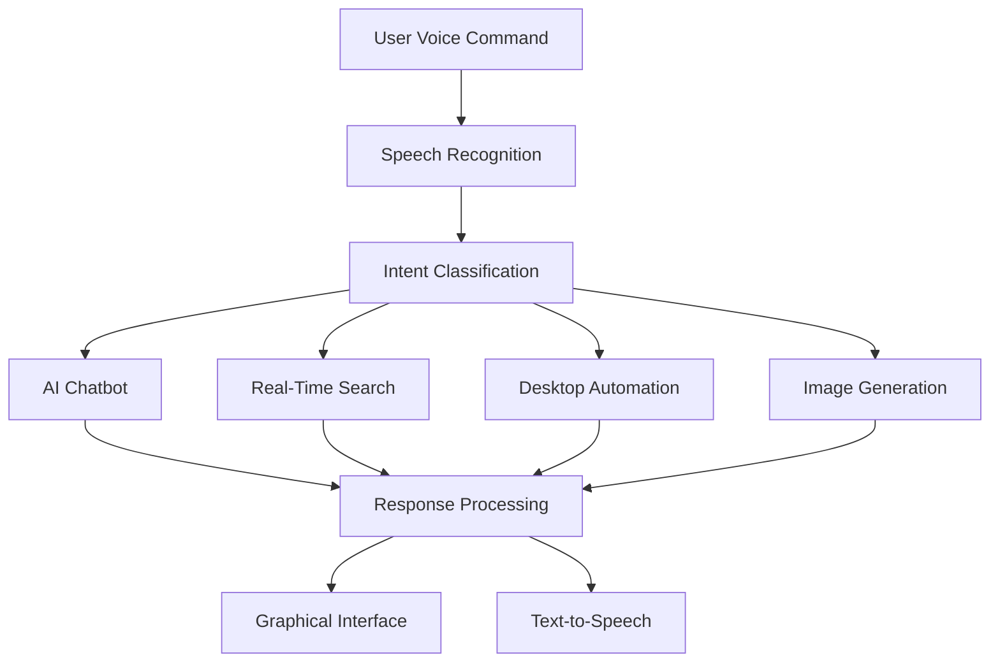

# 🤖 COCO AI Desktop Assistant


## 📌 Project Overview

COCO is an AI-powered desktop voice assistant developed using Python. It combines artificial intelligence, natural language processing, speech recognition, real-time information retrieval, and desktop automation to provide an interactive personal assistant experience.

The application features a graphical interface built with PyQt5 and integrates multiple AI services to process user queries and perform everyday tasks through voice commands.

## ✨ Key Features

- **Conversational AI:** Generates intelligent responses using Groq.
- **Speech Recognition:** Converts spoken commands into text.
- **Text-to-Speech:** Delivers natural spoken responses.
- **Real-Time Search:** Retrieves and summarizes online information.
- **AI Image Generation:** Generates images from text prompts.
- **Desktop Automation:** Opens applications and performs supported system tasks.
- **Content Generation:** Generates letters, articles, and documents.
- **Intent Classification:** Categorizes user requests using Cohere.
- **Graphical Interface:** Provides an interactive PyQt5 desktop interface.
- **Chat History:** Maintains conversation records locally.

## 🛠️ Technology Stack

| Technology | Purpose |
|---|---|
| Python | Core programming language |
| PyQt5 | Graphical user interface |
| Groq API | Conversational AI |
| Cohere API | Intent classification |
| Hugging Face | AI image generation integration |
| Selenium | Browser-based speech recognition |
| Edge TTS | Text-to-speech |
| Pygame | Audio playback |
| AppOpener | Desktop application management |
| Google Search | Online information retrieval |
| Python-dotenv | Environment configuration |
| Git & GitHub | Version control |

## 🏗️ System Architecture



## 📂 Project Structure

```text
COCO-AI-Desktop-Assistant/
├── Backend/
│   ├── Automation.py
│   ├── Chatbot.py
│   ├── ImageGeneration.py
│   ├── Model.py
│   ├── RealtimeSearchEngine.py
│   ├── SpeechToText.py
│   └── TextToSpeech.py
├── Frontend/
│   ├── Graphics/
│   └── GUI.py
├── Main.py
├── calender.py
├── Requirements.txt
├── .env.example
├── .gitignore
└── README.md
```

## ⚙️ Installation and Setup

### Prerequisites

- Windows operating system
- Python 3.13 recommended
- Google Chrome
- Internet connection
- Microphone and speakers
- Required API credentials

### Step 1: Clone the repository

```bash
git clone https://github.com/ayushd-3110/COCO-AI-Desktop-Assistant.git
cd COCO-AI-Desktop-Assistant
```

### Step 2: Create a virtual environment

```powershell
py -3.13 -m venv .venv
```

### Step 3: Install dependencies

```powershell
.\.venv\Scripts\python.exe -m pip install -r Requirements.txt
```

### Step 4: Configure environment variables

```powershell
Copy-Item .env.example .env
```

Open the `.env` file and configure the following values:

```env
Username=YourName
Assistantname=Coco

GroqAPIKey=your_groq_api_key
GroqModel=your_supported_groq_model

CohereAPIKey=your_cohere_api_key
CohereModel=your_supported_cohere_model

HuggingFaceAPIKey=your_huggingface_api_key
ImageAPIURL=your_compatible_image_endpoint

InputLanguage=en-IN
AssistantVoice=en-US-AriaNeural
```

Never commit actual API keys to GitHub.

### Step 5: Launch the application

```powershell
.\.venv\Scripts\python.exe Main.py
```

## 🎙️ Example Voice Commands

| Voice Command | Intended Function |
|---|---|
| Explain cloud computing | AI conversation |
| Open Notepad | Desktop automation |
| Search Google for Python tutorials | Web search |
| Play relaxing music | YouTube integration |
| Generate an image of a mountain | AI image generation |
| Write a professional application | Content generation |
| Increase system volume | System control |

## 🔐 Security and Privacy

- API credentials are maintained in a local `.env` file.
- Sensitive configuration files are excluded through `.gitignore`.
- Private conversation logs are excluded from the repository.
- Runtime and virtual environment files are excluded.
- Online AI and speech features may transmit user queries to external services.

## 🧪 Testing and Validation

- Python source syntax compilation completed.
- Python 3.13 dependency installation completed.
- Dependency consistency checked using `pip check`.
- Runtime initialization fixes identified.

Full end-to-end testing of AI providers, voice recognition,
audio playback, and desktop automation is ongoing.

## 🚀 Future Enhancements

- Offline speech recognition
- Wake-word detection
- Local AI model integration
- Reminder and calendar integration
- Multilingual voice interaction
- Improved error handling
- Automated unit and integration testing
- Windows executable packaging

## 🎯 Learning Outcomes

This project demonstrates practical experience in:

- Python application development
- AI API integration
- Natural language processing
- Desktop GUI development
- Speech recognition and synthesis
- Multithreading
- Asynchronous programming
- Error handling
- Git and GitHub version control

## 👨‍💻 Developer

**Ayush Dhumal**

GitHub: [@ayushd-3110](https://github.com/ayushd-3110)

---

⭐ If you find this project useful, consider starring the repository.
